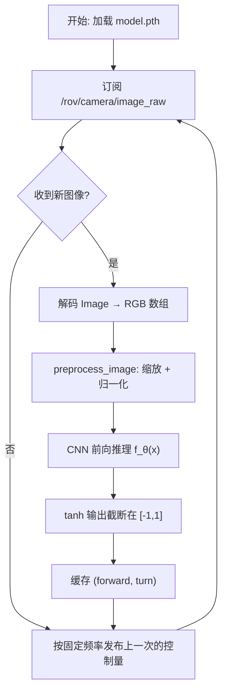
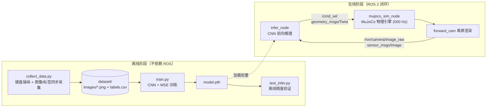
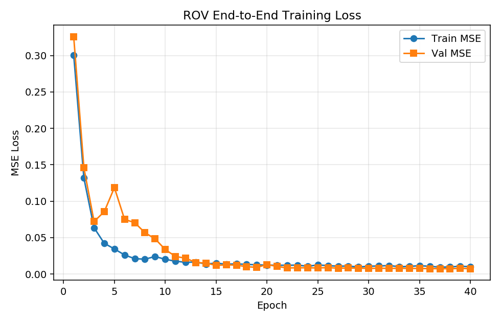
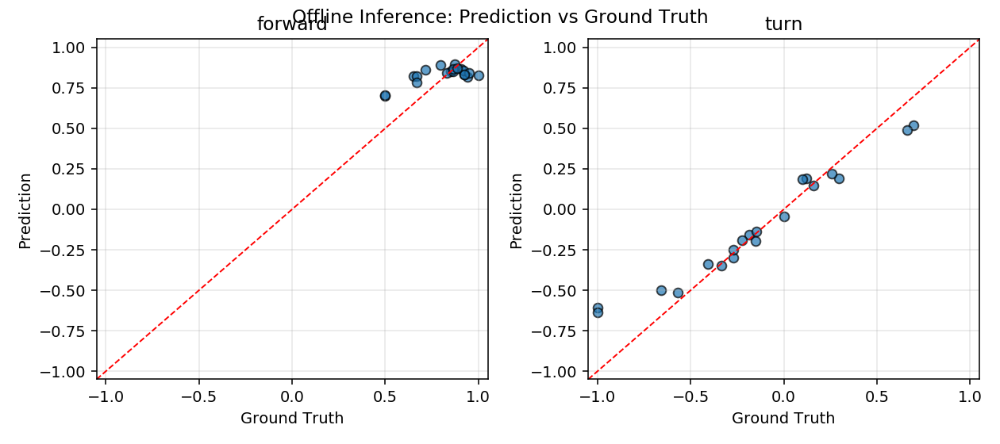

# 静水环境下单目视觉水下 ROV 前进-转向端到端神经网络控制

---

## 1. 概述与目标

本模块在已有 `rov_mujoco` 水下机器人 MuJoCo 物理仿真的基础上，构建**单目视觉端到端（End-to-End）控制**闭环：以 ROV 前视相机采集的 RGB 图像作为唯一观测量，经卷积神经网络直接回归出 **前进推力** 与 **转向** 两个连续控制量，交由 `/cmd_vel` 话题驱动仿真中的 ROV 在水下通道内自主前行。

与传统"感知 → 状态估计 → 规划 → 控制"分层架构不同，端到端方案**不做显式的目标检测或位姿估计**，而是让网络直接从像素学习"看到什么画面该给多少推力、打多少舵"，控制律完全由数据驱动获得。

### 核心任务目标

1. **自建数据集**：通过键盘手动操纵 ROV，同步记录前视相机画面与当时的控制指令，形成 `(图像, [前进推力, 转向])` 的行为克隆数据集；
2. **训练端到端网络**：设计小型 CNN，以 MSE 为损失函数回归两个连续控制量，产出权重文件 `model.pth`；
3. **离线验证权重**：提供不依赖 ROS 的离线测试脚本，量化网络输出与人工标签的一致程度；
4. **ROS 2 在线推理闭环**：推理节点订阅相机话题、发布控制话题，与 MuJoCo 仿真构成"感知—决策—控制"闭环；
5. **一键启动入口**：`ros2 launch rov_e2e main.launch.py` 同时拉起仿真与推理节点。

### 任务范围界定

- 环境设定为**静水**（`use_ocean_current=False`），不引入洋流扰动，使视觉输入与动力学关系相对确定，便于教学与复现；
- 控制自由度仅保留**前进推力**与**偏航转向**两个维度。垂向定深由 `mujoco_sim_node` 内置 PID 深度控制器承担，横滚/俯仰由姿态自稳力矩抑制，因此网络只需学习水平面内的驾驶行为；
- 本模块**不涉及**机械臂操作，UR5e 机械臂保持收纳姿态。

---

## 2. 软硬件环境

| 配置项 | 说明 |
| :--- | :--- |
| **操作系统** | Ubuntu 20.04 LTS（官方教学虚拟机） |
| **ROS 2 版本** | ROS 2 Humble |
| **Python 版本** | **Python 3.8**（系统默认；与 ROS 2 底层 `_rclpy_pybind11` 的 ABI 绑定，不可随意切换） |
| **物理引擎** | MuJoCo 3.0 / 3.1（`mujoco>=3.2` 要求 Python≥3.9，故不适用于 3.8 环境） |
| **深度学习框架** | PyTorch **2.4.1** + torchvision 0.19.1（**CPU 版本**） |
| **渲染后端** | `MUJOCO_GL=osmesa`（CPU 软件渲染，无显卡虚拟机必需） |
| **其他依赖** | numpy、pillow、matplotlib |
| **运行平台** | VMware 虚拟机，无独立显卡（不需要 CUDA） |

!!! warning "PyTorch 版本上限是硬约束"
    在 **Python 3.8** 环境下不能直接 `pip3 install torch`：PyTorch 自 **2.5.0** 起不再提供 Python 3.8 的 wheel，
    最后一个支持 3.8 的版本是 **torch 2.4.1 / torchvision 0.19.1**。版本已在
    `src/water/rov_e2e/requirements.txt` 中固定，请勿手动放宽。

!!! warning "无显卡虚拟机必须设置 `MUJOCO_GL`"
    MuJoCo 的 `Renderer` 离屏渲染需要一个 OpenGL 后端。教学虚拟机通常没有 GPU 直通，
    必须让 MuJoCo 走 **OSMesa 软件渲染**，否则相机模块初始化失败、
    `/rov/camera/image_raw` **不会发布任何图像**，端到端链路无从谈起。
    系统依赖与设置方式见 6.2 节。

---

## 3. 原理简述

### 3.1 行为克隆（Behavior Cloning）

把人工操纵过程视为一个隐含的专家策略 \(\pi^*\)：在每个时刻 \(t\)，专家观察到画面 \(o_t\)，输出控制指令 \(a_t = (u_t, r_t)\)，其中 \(u_t\) 为前进推力、\(r_t\) 为转向。数据集即专家轨迹上的采样：

\[
\mathcal{D} = \{(o_t, a_t)\}_{t=1}^{N}
\]

训练目标是让参数为 \(\theta\) 的网络 \(f_\theta\) 在最小二乘意义下逼近专家：

\[
\theta^\star = \arg\min_\theta \frac{1}{N}\sum_{t=1}^{N} \left\| f_\theta(o_t) - a_t \right\|_2^2
\]

即**均方误差（MSE）损失**。这是一个标准的监督回归问题，不涉及强化学习的奖励设计与试错探索，因而在 CPU 上也能快速收敛，适合课程作业规模。

### 3.2 网络结构

采用三层卷积 + 两层全连接的轻量结构（参数量约 2.2 万）：

```
输入 (3, 120, 160)
  ├─ Conv2d(3→16,  3×3, stride=2) + BN + ReLU      → (16, 60, 80)
  ├─ Conv2d(16→32, 3×3, stride=2) + BN + ReLU      → (32, 30, 40)
  ├─ Conv2d(32→64, 3×3, stride=2) + BN + ReLU      → (64, 15, 20)
  ├─ AdaptiveAvgPool2d(1)                          → (64, 1, 1)
  ├─ Flatten → Linear(64→32) + ReLU
  └─ Linear(32→2) + Tanh                           → (u, r) ∈ [-1, 1]²
```

设计要点：

- **`AdaptiveAvgPool2d(1)`** 使网络对输入分辨率不敏感，相机分辨率调整时无需改网络结构；
- **末层 `tanh`** 把输出限制在 \([-1, 1]\)，与标签量纲一致，也天然完成了控制量限幅，避免推理时出现发散指令；
- **BatchNorm** 在只有几百张样本的小数据集上能显著稳定训练；
- 网络刻意保持轻量，整机无 GPU 时单轮训练仅需数秒。

### 3.3 控制量到物理量的映射

网络输出经 `infer_node` 写入 `geometry_msgs/Twist`：

| 网络输出 | Twist 字段 | 物理含义 |
| :--- | :--- | :--- |
| \(u\) | `linear.x` | 纵向推进力，乘以 `force_scale = 350.0` 后施加于机体 |
| \(r\) | `angular.z` | 偏航力矩，乘以 `torque_scale = 90.0` 后施加于机体 |

`mujoco_sim_node` 在 500 Hz 物理循环中把上述指令映射为机体坐标系力与力矩，经旋转矩阵变换到世界系后注入 `data.xfrc_applied`，再叠加恒定浮力补偿与姿态自稳力矩，最后由 `mujoco.mj_step` 完成积分。

### 3.4 水下动力学（简述）

ROV 在水下的受力可概括为四项：重力、阿基米德浮力、各向异性流体阻力、推进器推力。仿真中通过设定浮力等于整机重力实现**中性浮力**，使 ROV 能够悬停；各向异性阻力由 MuJoCo 椭球流体模型给出，纵向阻力系数 \(c_x = 0.40\) 远小于侧向 \(c_y = 7.79\)，因此横向抗流能力弱而纵向流线型良好——这也是本任务把控制自由度收敛到"前进 + 转向"的物理依据。详细流体建模见 [`rov_physical_simulation.md`](./rov_physical_simulation.md)。

---

### 3.5 算法流程

整个模块分为**采集 → 训练 → 部署**三个阶段，各阶段的算法流程如下。

#### （1）数据采集流程 `collect_data.py`

```text
输入: MuJoCo 场景模型 + 人工按键序列
输出: dataset/images/*.png 与 dataset/labels.csv

初始化: 实例化 MujocoSimNode; 构造 UnderwaterCamera(enable_renderer=True)
        forward ← 0, turn ← 0, saved ← 0
循环直至 saved = N:
    spin_once(node)                    # 触发 500 Hz 物理步进定时器（单线程）
    key ← 非阻塞读取键盘
    若 key 为方向键:  (forward, turn) ← 该键对应指令   # 锁存，不松手即持续
    node.cmd_vel ← (linear.x = forward, angular.z = turn)
    若 到达采样周期 (1/sample_rate):
        frame ← camera.render()        # forward_cam 离屏渲染
        保存 frame → images/{saved:06d}.png
        追加一行 (filename, forward, turn) → labels.csv
        saved ← saved + 1
```

关键点：物理步进与图像采样在**同一线程内交替**执行（`spin_once` 触发定时器），
MuJoCo 不是线程安全的，这样避免渲染与步进竞争；同时因为直接复用了部署时的
`MujocoSimNode`，采集与部署的动力学严格一致。

#### （2）网络训练流程 `train.py`

```text
输入: dataset/labels.csv + images/
输出: model.pth, training_curve.png

1. 读取标签表，按文件名加载图像，尺寸归一化到 (H, W)
2. 像素归一化: x ← (x/255 − μ) / σ          # μ, σ 为 ImageNet 统计量
3. 按 80/20 划分训练集与验证集（固定随机种子保证可复现）
循环 epoch = 1..E:
    for (x, y) in 训练集:
        ŷ ← f_θ(x)                          # 前向传播
        L ← (1/B) Σ ‖ŷ − y‖²                # MSE 损失
        θ ← Adam(θ, ∇_θ L)                  # 反向传播 + Adam 更新
    每 10 个 epoch: 学习率 × 0.5             # StepLR
    在验证集上计算 L_val，若优于历史最优则保存 θ*
输出: θ* 连同输入分辨率与归一化参数写入 model.pth
```

保存的 `model.pth` 是**验证集 MSE 最低**的那一组权重，而非最后一轮的权重，
这在只有几百张样本的小数据集上能显著抑制过拟合。

#### （3）在线推理流程 `infer_node.py`

```text
输入: /rov/camera/image_raw (sensor_msgs/Image)
输出: /cmd_vel (geometry_msgs/Twist)

启动: 读取 model.pth → 载入 state_dict, 取回 (W, H) 与归一化参数
订阅 /rov/camera/image_raw (QoS = BEST_EFFORT)

收到图像 msg:
    frame ← 解码 msg.data 为 (H, W, 3) 的 RGB 数组    # 兼容 rgb8/bgr8 与行填充
    x ← preprocess_image(frame)                     # 与训练完全同一函数
    ŷ ← f_θ(x)                                      # 单次前向，CPU
    forward ← clip(ŷ[0]·k_f, −u_max, +u_max)
    turn    ← clip(ŷ[1]·k_t, −r_max, +r_max)        # 缓存，供定时器发布

每 1/publish_rate 秒:
    发布 Twist(linear.x = forward, angular.z = turn)
```

`/cmd_vel` 由**定时器定频发布**而不是在图像回调里直接发布：相机帧率抖动时
控制量保持上一次输出，避免推力频繁断续；节点退出时补发一次零指令，
避免 ROV 带着上一帧推力继续冲撞。



---

## 4. 软件架构与 ROS 话题

系统由两个功能包、三个节点构成：`rov_mujoco` 提供物理仿真与传感器，`rov_e2e` 提供数据、训练与推理。



### 4.1 话题接口

| 话题名称 | 消息类型 | 方向 | 频率 | 功能描述 |
| :--- | :--- | :--- | :--- | :--- |
| `/rov/camera/image_raw` | `sensor_msgs/msg/Image` | `infer_node` 订阅 | 约 25 Hz | 前视相机 `forward_cam` 渲染的 RGB 图像（本作业用 160×120） |
| `/cmd_vel` | `geometry_msgs/msg/Twist` | `infer_node` 发布 | 20 Hz | `linear.x` 前进推力，`angular.z` 转向 |
| `/rov/odom` | `nav_msgs/msg/Odometry` | 仿真节点发布 | 50 Hz | ROV 位姿与线速度（用于结果评估） |
| `/rov/depth` | `std_msgs/msg/Float64` | 仿真节点发布 | 50 Hz | 实时深度 |

!!! note "话题命名说明"
    相机话题是 **`/rov/camera/image_raw`**（带 `/rov` 前缀），
    与部分资料里写的 `/camera/image_raw` 不同。本模块通过参数 `image_topic` 暴露该话题名，
    如遇命名差异可直接覆盖而无需改代码：
    `ros2 run rov_e2e infer_node --ros-args -p image_topic:=/camera/image_raw`

### 4.2 节点参数

| 参数 | 默认值 | 所属节点 | 说明 |
| :--- | :--- | :--- | :--- |
| `model_path` | 自动探测 | `infer_node` | 权重路径；留空时自动在源码树中查找 `model.pth` |
| `image_topic` | `/rov/camera/image_raw` | `infer_node` | 相机图像话题 |
| `cmd_topic` | `/cmd_vel` | `infer_node` | 控制指令话题 |
| `forward_gain` / `turn_gain` | 1.0 | `infer_node` | 输出增益，用于调试时缩放动作幅度 |
| `max_forward` / `max_turn` | 1.0 | `infer_node` | 输出限幅 |
| `mujoco_gl` | `osmesa` | `main.launch.py` | MuJoCo 渲染后端 |

---

## 5. 关键源码说明

### 5.1 数据集采集 `collect_data.py`

采集脚本**不重新实现一套物理**，而是直接实例化 `rov_mujoco.mujoco_sim_node.MujocoSimNode`，
用**单线程 `spin_once` 循环**交替推进物理与采样图像：

```python
while saved < args.frames and rclpy.ok():
    # 1) 推进物理：500Hz 定时器在 spin_once 中触发，单线程安全
    rclpy.spin_once(node, timeout_sec=0.0)

    # 2) 读键盘，更新锁存指令
    key = kb.read_key(timeout=0.0)
    if key in KEY_TO_ACTION:
        forward, turn = KEY_TO_ACTION[key]

    # 3) 把锁存指令写入仿真节点（linear.x=推力, angular.z=转向）
    node.cmd_vel.linear.x = forward
    node.cmd_vel.angular.z = turn

    # 4) 到采样周期就存一帧（与仿真完全同源的相机）
    if time.time() >= next_sample:
        frame = node.camera.render()
        Image.fromarray(frame).save(...)
        writer.writerow([name, forward, turn])
```

这样设计解决了三个问题：

1. **动力学零差异**——训练数据与 `ros2 launch` 部署时的物理完全相同，不存在"采集一套动力学、部署另一套"的隐性偏差；
2. **线程安全**——MuJoCo 不是线程安全的，用 `spin_once` 交替而非多线程并发，避免渲染与步进竞争；
3. **按键锁存**——原 `keyboard_teleop_node` 是"按键瞬时触发"（松手即归零），
   直接照搬会导致数据集中绝大多数样本指令为 0，网络学不到有效策略。
   本脚本改为**锁存式**：按一次持续生效，直到按其他方向键或空格，使录制可单人完成且标签分布合理。

按键映射：`W/↑` 前进、`S/↓` 后退、`A/←` 左转、`D/→` 右转、`Q/E` 前进+左转/右转、`空格` 归零、`R` 重置位姿、`X` 退出。

### 5.2 训练脚本 `train.py`

除训练主流程外，本文件还**定义了网络结构 `ROVSteeringNet` 与预处理函数 `preprocess_image`**，
供 `test_infer.py` 与 `infer_node.py` 直接 import：

```python
try:
    from rov_e2e.train import ROVSteeringNet, preprocess_image
except ImportError:                     # 未 colcon 安装时以脚本方式运行
    sys.path.insert(0, os.path.dirname(os.path.dirname(os.path.abspath(__file__))))
    from rov_e2e.train import ROVSteeringNet, preprocess_image
```

**为什么要把预处理集中到一处**：端到端策略最常见的隐性 bug 是"训练与部署的预处理不一致"
（缩放插值方式、通道顺序、归一化统计量不同），会导致离线误差很低但上线行为异常。
本模块让训练与推理共用同一个 `preprocess_image()`，从结构上消除该风险。

训练使用 Adam 优化器（初始学习率 `1e-3`）配合 `StepLR`（每 10 轮衰减为 0.5 倍），
按 `val-split=0.2` 划分验证集，**保留验证集 MSE 最低的权重**而非最后一轮权重，
避免小数据集上的过拟合。训练结束后输出 `model.pth` 与 `training_curve.png`。

`model.pth` 中保存的不只是权重，还包含推理所需的元信息：

```python
payload = {
    'state_dict': model.state_dict(),
    'width': width, 'height': height,          # 输入分辨率
    'norm_mean': [...], 'norm_std': [...],     # 归一化参数
    'arch': 'ROVSteeringNet',
}
```

这样推理端无需硬编码分辨率与归一化参数，避免与训练端不一致。

### 5.3 离线测试 `test_infer.py`

不加载 ROS、不启动 MuJoCo，直接读取 `model.pth` 对数据集图像前向推理，
逐张打印「预测值 / 真值 / 误差」并统计平均绝对误差：

```text
  文件            预测(前进,转向)      真值(前进,转向)      误差
  000021.png      (+0.942, -0.118)    (+1.000, +0.000)    0.1304
  000104.png      (+0.887, +0.643)    (+1.000, +1.000)    0.3736
  ...
  平均绝对误差  forward MAE = ...
  平均绝对误差  turn    MAE = ...
```

加 `--plot` 可输出 `test_infer_result.png`（预测值 vs 真值散点图，理想情况点应贴近对角线）。

### 5.4 ROS 2 推理节点 `infer_node.py`

订阅 `/rov/camera/image_raw`，把 `sensor_msgs/Image` 解码为 `(H, W, 3)` 数组后推理，
再按固定频率发布 `/cmd_vel`：

```python
def _image_callback(self, msg: Image):
    frame = self._msg_to_array(msg)                       # 兼容 rgb8 / bgr8 与行填充
    arr = preprocess_image(PILImage.fromarray(frame), self.width, self.height)
    x = torch.from_numpy(arr.transpose(2, 0, 1)).unsqueeze(0).to(self.device)
    with torch.no_grad():
        out = self.model(x)[0].cpu().numpy()
    self.forward = float(np.clip(out[0] * self.forward_gain, -self.max_forward, self.max_forward))
    self.turn    = float(np.clip(out[1] * self.turn_gain,    -self.max_turn,    self.max_turn))
```

工程细节：

- **QoS 使用 `BEST_EFFORT`**：与多数仿真相机发布者的默认 QoS 匹配，避免因 QoS 不兼容而一帧都收不到（这是 ROS 2 相机话题最常见的"订阅了但没数据"原因）；
- **`_publish_callback` 定时发布**：新图像未到达时保持上一次输出，而不是让控制量掉到 0，
  避免相机帧率抖动导致推力频繁断续；
- **`destroy_node` 补发一次零指令**：退出时主动归零，避免 ROV 带着上一帧推力继续冲撞；
- **权重缺失时给出可操作的报错**，直接打印采集与训练命令，而不是抛裸异常。

### 5.5 一键启动 `main.launch.py`

```bash
ros2 launch rov_e2e main.launch.py
```

启动 `mujoco_sim_node`（仿真）与 `infer_node`（推理）两个节点，并注入渲染后端环境变量：

```python
set_gl   = SetEnvironmentVariable('MUJOCO_GL', LaunchConfiguration('mujoco_gl'))
set_pygl = SetEnvironmentVariable('PYOPENGL_PLATFORM', LaunchConfiguration('mujoco_gl'))
```

!!! note "为什么直接起 `mujoco_sim_node`，而不 include `rov_mujoco/main.launch.py`"
    `rov_mujoco` 的 launch 会**无条件**一并拉起 `keyboard_teleop_node`，
    而它同样向 `/cmd_vel` 发指令，会与推理节点**抢控制权**，导致 ROV 动作抖动。
    因此本 launch 直接实例化仿真节点，仅通过 `enable_teleop:=true` 按需追加遥控节点。

`SetEnvironmentVariable` 是必需的而非可选：`MUJOCO_GL` 必须在 `import mujoco` **之前**生效，
在 Python 代码里设置已经太晚（`mujoco` 已在模块顶层导入）。

### 5.6 使相机真正渲染场景（对 `rov_mujoco` 的必要改动）

本作业在 `mujoco_sim_node.py` 中新增了一个参数：

```python
self.declare_parameter('enable_camera_renderer', False)
...
self.camera = UnderwaterCamera(self.model, self.data, camera_name='forward_cam',
                               enable_renderer=enable_camera_renderer)
```

!!! warning "为什么必须开这个开关——这是本作业最容易踩的坑"
    `rov_mujoco.camera_sensor.UnderwaterCamera` 的 `enable_renderer` **默认是 `False`**。
    在该默认值下 `render()` 会走"轻量级水下色彩缓冲区"分支，返回一张
    **每个像素都相同的固定蓝绿底色图像**，其中**不含任何场景信息**：

    ```python
    # camera_sensor.py 中 enable_renderer=False 时的分支
    img = np.zeros((self.height, self.width, 3), dtype=np.uint8)
    img[:, :, 0] = 15    # 极低红光
    img[:, :, 1] = 85    # 中等绿光
    img[:, :, 2] = 135   # 蓝光主导
    ```

    也就是说，`/rov/camera/image_raw` **一直在正常发图、`ros2 topic hz` 也一切正常**，
    但窗口里的画面永远一模一样。用它采集的数据集，输入与标签之间不存在任何可学习的关系，
    网络只能退化成一个常数输出——**而整个过程不会报任何错**。
    这是比"相机完全没数据"更隐蔽的失败模式。

    因此本作业在采集与在线运行时都显式打开真实渲染；`rov_mujoco` 原有的
    默认行为（`False`）保持不变，以免与图形视窗抢占 OpenGL 上下文。

`rov_e2e/launch/main.launch.py` 中相应地传入：

```python
sim = Node(
    package='rov_mujoco', executable='mujoco_sim_node', ...,
    parameters=[{..., 'enable_camera_renderer': True}])
```

该值由 launch 参数 `enable_camera_renderer`（默认 `true`）控制，
如需临时关闭可用 `ros2 launch rov_e2e main.launch.py enable_camera_renderer:=false`。

`collect_data.py` 则在自己构造相机时直接传 `enable_renderer=True`，
并检查 `camera.renderer is not None`，不满足时立即报错退出，
从源头杜绝"采了一堆纯色图却毫无察觉"。

### 5.7 模块统一入口 `main.py` / `main.sh`

按作业要求，本模块的入口以 `main.` 开头，且**整个模块可以通过该入口直接运行**。
本模块提供三层入口，任选其一：

| 入口 | 用法 | 说明 |
| :--- | :--- | :--- |
| `main.sh` | `bash src/water/rov_e2e/main.sh run` | **推荐**。自动 `source` ROS 2 与工作空间环境、设置 `MUJOCO_GL=osmesa`，再转交 `main.py` |
| `main.py` | `python3 src/water/rov_e2e/main.py train` | 纯 Python 入口，需自行加载 ROS 环境 |
| `main.launch.py` | `ros2 launch rov_e2e main.launch.py` | ROS 2 标准 launch 入口，一键启动仿真 + 推理闭环 |

`main.py` 用子命令覆盖模块的全部能力，不带子命令时默认执行 `run`（即跑通整个闭环）：

```bash
python3 src/water/rov_e2e/main.py              # = run，一键启动完整闭环
python3 src/water/rov_e2e/main.py collect --frames 600
python3 src/water/rov_e2e/main.py train --epochs 30
python3 src/water/rov_e2e/main.py test --samples 10 --plot
python3 src/water/rov_e2e/main.py run model_path:=/abs/path/model.pth
```

```python
def main(argv=None):
    parser = build_parser()
    args = parser.parse_args(argv)
    if not getattr(args, 'command', None):
        # 不带子命令时默认为 run，方便「直接跑整个模块」
        argv = list(argv) if argv is not None else sys.argv[1:]
        args = parser.parse_args(['run'] + argv)
    return args.func(args) or 0
```

实现要点：`collect` / `train` / `test` 三个子命令**在本进程内**直接调用对应模块的 `main()`，
保持异常栈与日志完整、便于排查；`run` 子命令需要 ROS 2 launch 的进程编排能力，因此转交
`ros2 launch rov_e2e main.launch.py`（找不到 `ros2` 时给出加载环境的明确提示，而不是抛裸异常）。

此外模块内附带 `.gitattributes`（`*.sh text eol=lf`），避免仓库在 Windows 上开启
`core.autocrlf=true` 时把 `main.sh` 检出成 CRLF，导致 Linux 下报
`$'\r': command not found`。

---

## 6. 分步运行指南

### 6.1 编译功能包

```bash
cd ~/ros2
source /opt/ros/humble/setup.bash

# 需要同时编译 rov_mujoco（本包依赖其仿真节点与模型）
colcon build --packages-select rov_mujoco rov_e2e --symlink-install
source install/setup.bash
```

!!! tip "务必加 `--symlink-install`"
    该选项让安装目录符号链接到源码目录。由于 `model.pth` 是训练**之后**才产生的，
    使用 symlink 安装后无需重新 `colcon build`，`infer_node` 就能自动在源码树中找到权重。

**预期编译输出**：

```text
Starting >>> rov_mujoco
Finished <<< rov_mujoco [2.85s]
Starting >>> rov_e2e
Finished <<< rov_e2e [0.42s]

Summary: 2 packages finished [3.51s]
```

### 6.2 安装依赖与配置软件渲染

```bash
# Python 依赖（版本已在 requirements.txt 中固定）
pip3 install -r src/water/rov_e2e/requirements.txt

# 无显卡虚拟机：OSMesa 软件渲染所需的系统库与 Python 绑定
sudo apt install -y libosmesa6 libgl1 libglfw3
pip3 install PyOpenGL

# 让 MuJoCo 走 CPU 软件渲染（每个新终端都要执行，或写入 ~/.bashrc）
export MUJOCO_GL=osmesa
export PYOPENGL_PLATFORM=osmesa
```

验证渲染后端是否可用：

```bash
python3 -c "import mujoco, os; print('MUJOCO_GL =', os.environ.get('MUJOCO_GL')); \
m=mujoco.MjModel.from_xml_path('src/water/rov_mujoco/models/underwater_rov_with_arm.xml'); \
r=mujoco.Renderer(m, 120, 160); d=mujoco.MjData(m); mujoco.mj_forward(m,d); \
s=r.update_scene(d, camera='forward_cam'); f=r.render(); print('渲染成功, 图像尺寸 =', f.shape)"
```

预期输出：

```text
MUJOCO_GL = osmesa
渲染成功, 图像尺寸 = (120, 160, 3)
```

若此处报 GL 相关错误，请**先解决渲染问题再进行采集**。

**更关键的一步：验证画面会随位姿变化。** 只有"能渲染"还不够，必须确认渲染的是**场景**
而不是固定底色（这是 5.6 节那个坑的直接检测手段）：

```bash
python3 -c "
import os; os.environ.setdefault('MUJOCO_GL','osmesa')
import numpy as np, mujoco
m = mujoco.MjModel.from_xml_path('src/water/rov_mujoco/models/underwater_rov_with_arm.xml')
d = mujoco.MjData(m)
r = mujoco.Renderer(m, 120, 160)
q = m.jnt_qposadr[m.body_jntadr[mujoco.mj_name2id(m, mujoco.mjtObj.mjOBJ_BODY,'rov')]]
r.update_scene(d, camera='forward_cam'); a = r.render().astype(np.int16)
d.qpos[q+1] += 0.8                      # 把 ROV 横向挪动 0.8 m
mujoco.mj_forward(m, d)
r.update_scene(d, camera='forward_cam'); b = r.render().astype(np.int16)
print('位姿变化后画面平均像素差 =', float(np.abs(a-b).mean()))
"
```

判读标准：**平均像素差应显著大于 0**（通常几十以上）。
若结果接近 0，说明相机没有真正渲染场景，此时采集到的数据集毫无信息量
（参见 5.6 节与 Q1）。

### 6.3 采集数据集

```bash
cd ~/ros2
source /opt/ros/humble/setup.bash
source install/setup.bash
export MUJOCO_GL=osmesa

python3 src/water/rov_e2e/rov_e2e/collect_data.py --frames 600 --sample-rate 10
```

终端会打印操作说明，随后即可用键盘驾驶 ROV：

- `W` / `↑` 前进，`S` / `↓` 后退
- `A` / `←` 左转，`D` / `→` 右转
- `Q` / `E` 前进同时左转 / 右转（用于覆盖转弯中的前进样本）
- `空格` 归零悬停，`R` 重置位姿，`X` 保存并退出

**采集策略建议**：让 ROV 在画面中经历「左偏 → 居中 → 右偏」三种状态，
交替给出左转 / 直行 / 右转指令。若长时间保持同一动作，
数据集中标签近乎为常数，网络会退化为常数输出，自动航行时只会直冲。

**预期输出**：

```text
  已采集 20/600 帧 | 位置=(+0.42, -0.03, -1.00) | 指令=(+1.0, +0.0)
  已采集 40/600 帧 | 位置=(+0.85, +0.11, -1.00) | 指令=(+1.0, -1.0)
  ...
采集结束：共保存 600 帧
  图像: /home/<user>/ros2/src/water/rov_e2e/dataset/images
  标签: /home/<user>/ros2/src/water/rov_e2e/dataset/labels.csv
```

### 6.4 训练得到 `model.pth`

```bash
python3 src/water/rov_e2e/rov_e2e/train.py --epochs 30
```

**预期输出**（数值以实际采集数据为准）：

```text
==============================================================
  ROV 端到端控制网络训练
==============================================================
  数据集      : /home/<user>/ros2/src/water/rov_e2e/dataset
  样本总数    : 600  (训练 480 / 验证 120)
  输入分辨率  : 160x120
  网络参数量  : 22,178
  设备        : cpu  轮数: 30  批大小: 32
--------------------------------------------------------------
  Epoch   1/30  train_MSE=...  val_MSE=...
  ...
  Epoch  30/30  train_MSE=...  val_MSE=...
--------------------------------------------------------------
  ✅ 权重已保存: .../rov_e2e/model.pth
     最佳验证 MSE: ...
  ✅ 损失曲线: .../rov_e2e/training_curve.png
==============================================================
```

### 6.5 离线测试权重

```bash
python3 src/water/rov_e2e/rov_e2e/test_infer.py --samples 10 --plot
```

该步骤**不启动 ROS**，用于证明 `model.pth` 真实可用（作业硬性要求之二）。
输出逐样本的预测值与真值对比、平均绝对误差，并可选生成散点图。

### 6.6 一键运行整套仿真

```bash
cd ~/ros2
source /opt/ros/humble/setup.bash
source install/setup.bash

ros2 launch rov_e2e main.launch.py
```

推理节点会持续打印控制输出：

```text
[rov_e2e_infer_node] 权重已加载: .../model.pth | 输入 160x120 | 训练轮数=30
[rov_e2e_infer_node] 端到端推理节点已启动 | 订阅 /rov/camera/image_raw → 发布 /cmd_vel
[rov_e2e_infer_node] 推理 #20 | 图像 160x120 | 前进推力=+0.9421 | 转向=-0.1132
[rov_e2e_infer_node] 推理 #40 | 图像 160x120 | 前进推力=+0.9105 | 转向=+0.2264
```

另开终端验证闭环数据流：

```bash
source /opt/ros/humble/setup.bash
source install/setup.bash

ros2 topic list
ros2 topic hz /rov/camera/image_raw      # 确认相机真的有数据（约 10 Hz）
ros2 topic echo /cmd_vel                 # 观察推理输出的控制指令
ros2 topic echo /rov/odom                # 观察 ROV 位姿是否持续推进
```

### 6.7 常见问题排查

#### Q1: 相机话题有数据，但训练出来的网络只会输出常数（不转弯 / 不动）

**原因**：`enable_camera_renderer` 没有打开，`/rov/camera/image_raw` 发布的是
**恒定不变的合成底色图像**（详见 5.6 节）。话题频率、图像尺寸、编码全部正常，
所以 `ros2 topic hz` **查不出问题**，必须比对图像内容。

**解决**：确认采集与运行时都传入了 `enable_renderer=True` /
`enable_camera_renderer:=true`，并用 6.2 节的"两帧是否相同"自检脚本验证画面确实在变化。

#### Q1b: `/rov/camera/image_raw` 完全没有数据

**原因**：`mujoco_sim_node` 启动时 sonar / camera / trajectory 模块整体导入失败，
导致 `self.camera` 被置为 `None`。

**解决**：查看 `mujoco_sim_node` 启动日志中的告警；确认
`colcon build --packages-select rov_mujoco rov_e2e` 成功、且已 `source install/setup.bash`。

#### Q2: 运行提示 `ModuleNotFoundError: No module named 'mujoco'`

```bash
pip3 install -r src/water/rov_e2e/requirements.txt
```

#### Q3: `cannot import name '_rclpy_pybind11'` / `.so isn't present`

在 Ubuntu 20.04 教学虚拟机中误用了 Python 3.10 环境。ROS 2 Humble 的 C 扩展是针对
**Python 3.8** 编译的，必须使用系统默认 `python3`（或 3.8 的 conda 环境）：

```bash
conda deactivate          # 或 conda activate nn_3.8
python3 --version         # 应输出 Python 3.8.x
```

#### Q4: `ros2 launch` 报 `Package 'rov_e2e' not found`

当前终端未加载工作空间环境：

```bash
source install/setup.bash
```

#### Q5: 推理节点报 `找不到权重文件 ... model.pth`

尚未训练，或未使用 `--symlink-install` 编译导致探测路径失效：

```bash
# 方式一：先完成 6.3 / 6.4 的采集与训练
# 方式二：显式指定权重绝对路径
ros2 launch rov_e2e main.launch.py model_path:=$PWD/src/water/rov_e2e/model.pth
```

#### Q6: ROV 自动航行时只会直冲、不会转弯

数据集类别不平衡——转弯样本过少。重新采集时确保充分覆盖左转 / 右转动作，
并检查 `test_infer.py` 中 `turn MAE` 是否明显大于 `forward MAE`。

---

### 6.8 多场景测试与性能评价

对应作业要求「所有任务均在仿真环境下完成，推荐使用多个场景进行测试，且包含性能评价」。

#### （1）场景定义 `config/scenarios.yaml`

除基准场景外，另设 5 个场景考察泛化能力（静水/洋流、不同初始深度与艏向）：

| 场景 | 环境 | 初始深度 | 初始艏向 | 考察点 |
| :--- | :--- | :--- | :--- | :--- |
| `S1_still_water_shallow` | 静水 | −1.0 m | 0° | 基准场景（采集/训练均用它） |
| `S2_still_water_deep` | 静水 | −3.0 m | 0° | 深度变化对视觉的影响 |
| `S3_yaw_offset_left` | 静水 | −1.0 m | +15° | 网络的纠偏能力 |
| `S4_yaw_offset_right` | 静水 | −1.0 m | −15° | 与 S3 对称 |
| `S5_mild_current` | 洋流 0.3 m/s | −1.5 m | 0° | 抗流鲁棒性 |
| `S6_strong_current` | 洋流 0.8 m/s | −2.0 m | 0° | 压力测试 |

#### （2）评价脚本 `evaluate.py` 的四种模式

| 模式 | 命令 | 是否需要 ROS/MuJoCo | 产出 |
| :--- | :--- | :--- | :--- |
| `offline` | `main.py evaluate offline --samples 0` | 不需要（需 torch） | 精度与推理耗时指标 `evaluation_report.json` |
| `record` | `main.py evaluate record --out runs/S1_odom.csv --duration 30` | 需要 | 一次闭环航行的里程计 CSV |
| `report` | `main.py evaluate report --log runs/S1_odom.csv --target-distance 5.0` | 不需要 | 闭环指标 JSON + 曲线图 |
| `compare` | `main.py evaluate compare --reports runs/*_report.json --out runs/compare.md` | 不需要 | 多场景对比 Markdown 表 |

#### （3）指标定义

**开环指标**（模型自身的精度与实时性）：

\[
\text{MAE}_u = \frac{1}{N}\sum_{i=1}^{N}\left|\hat u_i - u_i\right|, \qquad
\text{MAE}_r = \frac{1}{N}\sum_{i=1}^{N}\left|\hat r_i - r_i\right|
\]

\[
\text{MSE} = \frac{1}{2N}\sum_{i=1}^{N}\left[(\hat u_i-u_i)^2 + (\hat r_i-r_i)^2\right]
\]

单帧推理耗时取均值与 P95；理论最高推理频率 \(f_{\max} = 1000 / \bar{t}\)（ms）。

**闭环指标**（以初始艏向 \(\psi_0\) 建立前进/横向坐标系）：

\[
\boldsymbol{u} = \begin{bmatrix}\cos\psi_0 \\ \sin\psi_0\end{bmatrix}, \qquad
\boldsymbol{v} = \begin{bmatrix}-\sin\psi_0 \\ \cos\psi_0\end{bmatrix}
\]

前进距离与横向偏差：

\[
d = (\boldsymbol{p}_{\text{end}} - \boldsymbol{p}_{\text{start}})\cdot\boldsymbol{u}, \qquad
e(t) = \left|(\boldsymbol{p}(t) - \boldsymbol{p}_{\text{start}})\cdot\boldsymbol{v}\right|
\]

任务成功率（要求走够距离且横向不越界）：

\[
\text{Success} = \mathbb{1}\left[\, d \ge d_{\text{target}} \;\wedge\; \max_t e(t) \le e_{\text{tol}} \,\right]
\]

另记录平均前进速度 \(d / T\) 与深度波动 \(\sigma_z = \mathrm{std}(z)\)。

#### （4）多场景对比表

```bash
# 逐个场景跑闭环并记录，再汇总
for s in S1_still_water_shallow S2_still_water_deep S3_yaw_offset_left \
         S4_yaw_offset_right S5_mild_current S6_strong_current; do
    echo "=== 场景 $s ==="
    # 按 config/scenarios.yaml 中该场景的参数启动仿真与推理（见 6.6 节）
    ros2 launch rov_e2e main.launch.py &
    sleep 3
    python3 src/water/rov_e2e/rov_e2e/evaluate.py record \
        --out runs/${s}_odom.csv --duration 30
    pkill -f mujoco_sim_node; pkill -f infer_node; sleep 2
    python3 src/water/rov_e2e/rov_e2e/evaluate.py report \
        --log runs/${s}_odom.csv --target-distance 5.0 --lateral-tol 0.5 --plot
done

python3 src/water/rov_e2e/rov_e2e/evaluate.py compare --reports runs/*_report.json \
    --out runs/compare.md
```

`compare.md` 会生成如下形式的对比表（数值待实测填充）：

| 场景 | 前进距离(m) | 平均速度(m/s) | 横向MAE(m) | 横向最大(m) | 深度σ(m) | 成功 |
| :--- | :--- | :--- | :--- | :--- | :--- | :--- |
| S1_still_water_shallow | <!-- 补充 --> | | | | | |
| S2_still_water_deep | <!-- 补充 --> | | | | | |
| S3_yaw_offset_left | <!-- 补充 --> | | | | | |
| S4_yaw_offset_right | <!-- 补充 --> | | | | | |
| S5_mild_current | <!-- 补充 --> | | | | | |
| S6_strong_current | <!-- 补充 --> | | | | | |

成功率：<!-- 补充 -->

---

## 7. 实验结果

### 7.1 数据集统计

<!-- TODO(提交前补充)：粘贴 dataset/labels.csv 的样本数统计与指令分布 -->

| 项目 | 数值 |
| :--- | :--- |
| 采集帧数 | <!-- 补充 --> |
| 图像分辨率 | 160 × 120 |
| 训练 / 验证划分 | 80% / 20% |
| 前进指令分布 | <!-- 补充 --> |
| 转向指令分布 | <!-- 补充 --> |

### 7.2 训练过程

<!-- TODO(提交前补充)：插入 training_curve.png -->



*图 7.1：训练集与验证集 MSE 随轮次下降曲线，由 train.py 自动生成。*

| 指标 | 数值 |
| :--- | :--- |
| 训练轮数 | <!-- 补充 --> |
| 最终训练 MSE | <!-- 补充 --> |
| 最佳验证 MSE | <!-- 补充 --> |

### 7.3 离线推理验证

<!-- TODO(提交前补充)：粘贴 test_infer.py 的真实输出，并插入 test_infer_result.png -->

```text
（此处粘贴 python3 src/water/rov_e2e/rov_e2e/test_infer.py --samples 10 --plot 的真实输出）
```



*图 7.2：离线推理预测值与人工标签的散点对比，理想情况下点应贴近红色对角线。*

### 7.4 在线闭环自主航行

<!-- TODO(提交前补充)：录屏 gif 并插入，同时粘贴 ros2 topic hz / /cmd_vel 的真实输出 -->


*图 7.3：`ros2 launch rov_e2e main.launch.py` 一键启动后，ROV 仅依据前视相机图像
自主输出前进推力与转向指令，在水下通道中持续前行。*

**闭环数据流验证**：

```text
（此处粘贴 ros2 topic hz /rov/camera/image_raw 与 ros2 topic echo /cmd_vel 的真实输出）
```

### 7.5 结果分析

<!-- TODO(提交前补充)：结合以上真实数据，分析网络学到了什么、误差来源与局限 -->

---

## 8. 结论与展望

本模块在已有 MuJoCo 水下 ROV 物理仿真的基础上，完成了从**数据采集 → 网络训练 → 离线验证 → ROS 2 在线闭环**的完整端到端控制链路：

1. 构建了键盘行为克隆数据集，图像与控制标签严格同步，且与部署时动力学完全一致；
2. 设计了轻量 CNN 回归网络，以 MSE 为损失、`tanh` 限幅输出，可在无 GPU 的教学虚拟机上训练；
3. 提供了不依赖 ROS 的离线验证脚本，量化网络输出与人工标签的一致程度；
4. 推理节点与仿真节点通过 `/rov/camera/image_raw` 与 `/cmd_vel` 构成闭环，一条 `ros2 launch rov_e2e main.launch.py` 即可复现。

**已知局限**：

- **分布漂移（distribution shift）**：行为克隆只学到专家状态分布上的映射，
  一旦 ROV 因累积误差偏离训练分布（例如贴到池壁），网络缺乏恢复能力。
  缓解方向：在采集时刻意引入偏离—回正样本，或采用 DAgger 迭代式数据增广；
- **无时序记忆**：当前网络是逐帧前馈的，不含循环结构，无法利用历史判断运动趋势。
  可扩展为 CNN + LSTM/GRU，或直接输入连续多帧；
- **任务范围有限**：仅在静水、固定通道、两自由度条件下验证，尚未涉及洋流扰动与三维路径跟踪。

**后续扩展方向**：

1. 引入 `rov_mujoco` 中已建模的三层级联洋流，研究扰动下的鲁棒性；
2. 把奖励信号引入训练（如 DRL 或 IRL），摆脱对人工示范的依赖；
3. 结合已有的多波束前视声呐形成声视觉融合感知，提升浑浊水域下的可靠性。
