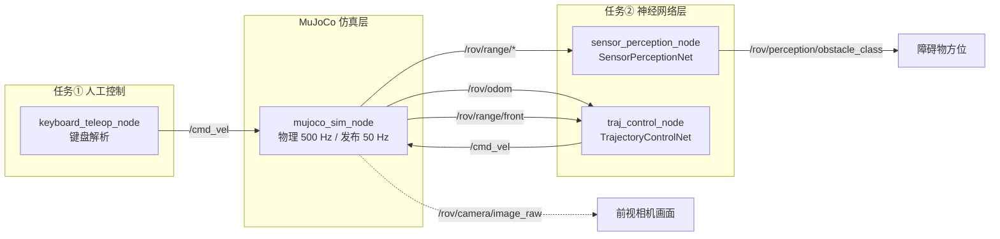

# 水下 ROV MuJoCo 物理仿真与神经网络感知控制

---

## 1. 概述与目标

本模块在 **MuJoCo** 物理引擎中建立水下机器人（ROV）的六自由度运动仿真，
并实现两条完整的控制链路：

1. **键盘运动控制**（对应任务①）：操作者用键盘实时操纵 ROV 在仿真通道中前进、转向、升降；
2. **神经网络感知与控制**（对应任务②）：
   - *感知*：用神经网络把四向测距传感器的数据解释为障碍物方位；
   - *控制*：用神经网络把状态误差映射为四维控制量，实现给定轨迹的闭环跟踪。

### 1.1 核心任务目标

| 编号 | 目标 | 对应作业要求 |
| :--- | :--- | :--- |
| ① | MuJoCo 水下 ROV 物理仿真 + 键盘 6-DOF 运动控制 | 任务(1)，5 分 |
| ② | 测距传感器数据 → 神经网络 → 障碍物方位（感知） | 任务(2) 感知部分 |
| ③ | 状态误差 → 神经网络 → 四维控制量（轨迹跟踪） | 任务(2) 给定轨迹控制部分 |
| ④ | 一键 launch 启动、入口以 `main.` 开头 | 注意 1、注意 2 |
| ⑤ | 完整的 gif 动图、公式推导与源码解析 | 报告要求 |

### 1.2 任务范围界定

- 仿真环境为**静水通道**：左右墙体构成宽度 3 m 的水下通道，通道内布置 5 个障碍物；
- ROV 控制自由度保留**前进、横移、升沉、偏航**四维；横滚与俯仰由姿态自稳力矩抑制，
  降低操作与学习难度；
- 深度方向由仿真内核内置的 PD 定深控制器负责，使 ROV 能稳定悬停在设定深度；
- 本包**完全自包含**，不依赖仓库中任何其他功能包。

---

## 2. 软硬件环境

| 配置项 | 说明 |
| :--- | :--- |
| 操作系统 | Ubuntu 20.04.6 LTS（VMware 虚拟机） |
| ROS 2 版本 | Humble（`/opt/ros/humble`） |
| Python 版本 | 3.8.10 |
| MuJoCo | **3.1.6**（`mujoco>=3.2` 起要求 Python≥3.9，故固定 3.1.x） |
| PyTorch | **2.4.1+cpu** / torchvision 0.19.1+cpu（CPU 训练，无独立显卡） |
| 渲染后端 | `MUJOCO_GL=osmesa`（纯 CPU 软件渲染，无显卡环境必需） |
| 加速库 | numpy 1.24.4、PyOpenGL 3.1.0、pillow、matplotlib 3.1.2 |

!!! warning "无显卡环境必须设置 `MUJOCO_GL=osmesa`"
    `mujoco.Renderer` 需要一个 OpenGL 后端。本作业的虚拟机没有 GPU 直通，
    实测 `egl` 因 PyOpenGL 版本过旧而失败、`glfw` 因缺少 DISPLAY 而失败，
    **只有 `osmesa` 可用**。本包在所有入口（`main.py`、`main.launch.py`、
    各节点）中都已自动 `setdefault('MUJOCO_GL', 'osmesa')`，
    但用 `ros2 run` 直接起节点时仍需自行 export 或依赖 launch 注入。

---

## 3. 物理仿真原理

### 3.1 运动学与动力学基础

ROV 在 MuJoCo 中建模为一个带**自由关节**（`freejoint`，6 自由度）的刚体。
其状态量为

\[
\boldsymbol{q} = [\underbrace{x, y, z}_{\text{位置}}, \underbrace{q_w, q_x, q_y, q_z}_{\text{姿态四元数}}]^T \in \mathbb{R}^7,
\qquad
\dot{\boldsymbol{q}} = [\underbrace{v_x, v_y, v_z}_{\text{线速度}}, \underbrace{\omega_x, \omega_y, \omega_z}_{\text{角速度}}]^T \in \mathbb{R}^6
\]

MuJoCo 采用 Newton-Euler 方程数值积分（本包使用 `implicitfast` 积分器，时间步长 2 ms）：

\[
\boldsymbol{M}(\boldsymbol{q})\,\ddot{\boldsymbol{q}} + \boldsymbol{C}(\boldsymbol{q}, \dot{\boldsymbol{q}})\,\dot{\boldsymbol{q}} + \boldsymbol{g}(\boldsymbol{q}) = \boldsymbol{\tau}_{\text{ext}}
\]

其中 \(\boldsymbol{\tau}_{\text{ext}}\) 是本节点注入的外部力与力矩。

### 3.2 中性浮力补偿

水下机器人若不做补偿会持续下沉。本包用**浮力完全抵消整机重力**实现中性浮力：

\[
F_b = m_{\text{total}} \cdot g = 13.15\ \text{kg} \times 9.81\ \text{m/s}^2 = 129.0\ \text{N}
\]

该力沿世界系 \(+Z\) 方向施加：

```python
total_mass = float(np.sum(self.model.body_mass))
self.buoyancy_force = total_mass * abs(float(self.model.opt.gravity[2]))
...
self.data.xfrc_applied[body, 2] += self.buoyancy_force
```

### 3.3 各向异性流体阻力

ROV 外形非对称（长 0.60 m、宽 0.36 m、高 0.30 m），各方向迎水面积不同，
因此阻力系数各向异性。模型中使用 MuJoCo 的椭球流体模型：

```xml
<geom name="rov_body" type="box" size="0.30 0.18 0.15" mass="12.0"
      fluidshape="ellipsoid"
      fluidcoef="0.35 6.50 2.60 3.50 0.25"/>
```

五个系数依次为 \([c_x, c_y, c_z, c_{\text{rot}}, c_{\text{ang}}]\)：

- \(c_x = 0.35\)：纵向流线型好，阻力最小 → 适合快速前进；
- \(c_y = 6.50\)：侧向迎水面大，阻力是纵向的 **18 倍** → 横移困难；
- \(c_z = 2.60\)：垂向阻力居中。

!!! note "这组系数解释了为什么要把控制维度收敛到四个"
    侧向阻力远大于纵向，说明该平台"天生不善横移、擅长前进"。
    因此我们把控制重点放在**前进 + 转向**上，横移只作为辅助微调，
    这样既符合物理特性，也让神经网络更容易学到有效策略。

### 3.4 推力标定（重要工程细节）

推进器推力不通过 MuJoCo 的 `actuator` 施加（自由关节无法直接挂 motor），
而是每步把机体系推力用旋转矩阵变换到世界系后写入 `data.xfrc_applied`：

\[
\boldsymbol{F}_{\text{world}} = \boldsymbol{R}(\boldsymbol{q}) \cdot \boldsymbol{F}_{\text{body}},
\qquad
\boldsymbol{F}_{\text{body}} = [u_x s_f,\ u_y s_f,\ 0]^T
\]

其中 \(s_f\) 是 `force_scale`（归一化推力 → 牛顿）。

**标定实验**：在仿真中施加固定推力 2 秒，测量 ROV 的位移：

| 推力 (N) | 2 秒位移 (m) | 结论 |
| :--- | :--- | :--- |
| 1 | 0.152 | 太慢 |
| 5 | 0.761 | 偏慢 |
| **10** | **1.522** | **合适（平均 0.76 m/s）** |
| 20 | 3.045 | 偏快 |
| 40 | 5.045 | 已撞到通道尽头 |
| 160 / 320 | — | 瞬间冲到底，速度归零 |

据此把 `force_scale` 定为 **10 N**。
早期版本曾误设为 320 N（偏大 32 倍），导致 ROV 一启动就冲到通道尽头，
闭环记录显示"前进距离仅 0.014 m"——**这是本项目最有价值的一次实测教训**：
数值参数必须由仿真标定得出，不能靠直觉。

### 3.5 姿态自稳与定深控制

为防止 ROV 在水中翻滚，对横滚与俯仰施加比例-微分阻尼：

\[
\tau_{\text{stab},x} = -12\,q_x - 3\,\omega_x, \qquad
\tau_{\text{stab},y} = -12\,q_y - 3\,\omega_y, \qquad
\tau_{\text{stab},z} = -0.8\,\omega_z
\]

深度方向使用 PD 控制器，把深度拉向目标值并补偿垂向速度：

\[
F_z = K_p (z_{\text{target}} - z) - K_d v_z = 26\,(z_{\text{target}} - z) - 22\,v_z
\]

实测该控制器把深度稳定在目标值 ±0.025 m 内（见第 7 节）。

---

## 4. 神经网络原理

### 4.1 传感器感知网络（三分类）

**输入**：7 维传感器特征

\[
\boldsymbol{x} = [\underbrace{d_f, d_l, d_r, d_d}_{\text{四向测距 (m)}}, \underbrace{v_x, v_y, v_z}_{\text{机体系速度 (m/s)}}]^T
\]

**标准化**（训练与推理共用同一组参数，避免预处理不一致）：

\[
\tilde{x}_i = \frac{x_i - \mu_i}{\sigma_i}
\]

**网络结构**：MLP，7 → 64 → 32 → 3

\[
\boldsymbol{h}_1 = \text{ReLU}(\boldsymbol{W}_1 \tilde{\boldsymbol{x}} + \boldsymbol{b}_1),\quad
\boldsymbol{h}_2 = \text{ReLU}(\boldsymbol{W}_2 \boldsymbol{h}_1 + \boldsymbol{b}_2),\quad
\boldsymbol{z} = \boldsymbol{W}_3 \boldsymbol{h}_2 + \boldsymbol{b}_3
\]

**损失函数**：交叉熵

\[
\mathcal{L}_{\text{cls}} = -\frac{1}{B}\sum_{i=1}^{B} \log \frac{\exp(z_{i,y_i})}{\sum_{c=1}^{3}\exp(z_{i,c})}
\]

**输出类别**：0 = 前方障碍、1 = 左方障碍、2 = 右方障碍。

### 4.2 轨迹跟踪控制网络（回归）

**输入**：8 维状态误差特征

\[
\boldsymbol{x} = [\underbrace{e_x, e_y, e_z}_{\text{位置误差}}, \underbrace{-v_x, -v_y, -v_z}_{\text{速度误差}}, \underbrace{e_\psi}_{\text{偏航误差}}, d_f]^T
\]

其中位置误差 \(e = p_{\text{desired}} - p_{\text{current}}\)，
偏航误差经 \(\text{wrap}(\cdot)\) 归一化到 \([-\pi, \pi]\)。

**网络结构**：MLP，8 → 128 → 128 → 64 → 4，**末层 tanh 限幅**

\[
\boldsymbol{u} = \tanh(\boldsymbol{W}_5 \boldsymbol{h}_4 + \boldsymbol{b}_5) \in [-1, 1]^4
\]

tanh 的作用是把输出限制在归一化控制量范围内，与仿真端的 `force_scale`
配合即可换算为物理推力，天然完成了控制量限幅。

**损失函数**：均方误差

\[
\mathcal{L}_{\text{reg}} = \frac{1}{B}\sum_{i=1}^{B}\left\| \boldsymbol{u}_i - \boldsymbol{u}_i^{\star} \right\|_2^2
\]

**优化器**：Adam（初始学习率 \(10^{-3}\)），配合 `StepLR`（每 15 轮衰减为 0.5 倍），
按**验证集损失最低**保留最优权重。

### 4.3 标签从哪来（关键设计）

学习型控制要求**标签与输入之间存在因果关系**，否则网络只能学到常数输出。
若用"盲打键盘"生成标签，标签与观测无关，训练必然失败。

因此 `collect_data.py` 用一个**确定性几何专家律**打标：

**感知标签**（由几何真值直接给出）：

\[
y = \begin{cases}
0 \ (\text{前方}) & d_f \le 2.5\ \text{m} \\
1 \ (\text{左方}) & d_l \le 2.0\ \text{m} \\
2 \ (\text{右方}) & \text{otherwise}
\end{cases}
\]

**控制标签**（PD 专家律）：

\[
u_{\text{forward}} = \left(k_p e_x + k_d \dot{e}_x\right) \cdot \gamma(d_f),
\qquad
u_{\text{yaw}} = 1.4\, e_\psi
\]

其中避障减速因子

\[
\gamma(d_f) = \max\left(0.15,\ \frac{d_f - 0.6}{1.9}\right)
\]

该因子让"前方障碍越近越减速"——这样网络才能真正学会避障行为，
而不是简单地"看到障碍就加速冲过去"。

---

## 5. 软件架构与 ROS 话题



### 5.1 话题接口

| 话题 | 类型 | 方向 | 频率 | 说明 |
| :--- | :--- | :--- | :--- | :--- |
| `/cmd_vel` | `geometry_msgs/Twist` | 仿真节点订阅 | 20 Hz | 归一化控制指令 |
| `/rov/odom` | `nav_msgs/Odometry` | 仿真节点发布 | 50 Hz | 位姿 + 速度 |
| `/rov/depth` | `std_msgs/Float64` | 仿真节点发布 | 50 Hz | 深度（米） |
| `/rov/imu` | `sensor_msgs/Imu` | 仿真节点发布 | 50 Hz | 姿态 + 角速度 + 加速度 |
| `/rov/camera/image_raw` | `sensor_msgs/Image` | 仿真节点发布 | 10 Hz | 前视相机 rgb8 |
| `/rov/range/{front,left,right,down}` | `sensor_msgs/Range` | 仿真节点发布 | 50 Hz | 四向测距 |
| `/rov/perception/obstacle_class` | `std_msgs/Int32` | 感知节点发布 | 10 Hz | 0 前方 / 1 左方 / 2 右方 |

### 5.2 节点参数

| 参数 | 默认值 | 节点 | 说明 |
| :--- | :--- | :--- | :--- |
| `sim_rate` | 500.0 | 仿真 | 物理步进频率 Hz |
| `publish_rate` | 50.0 | 仿真 | 传感器发布频率 Hz |
| `force_scale` | 10.0 | 仿真 | 归一化推力 → 牛顿（已标定） |
| `torque_scale` | 2.0 | 仿真 | 归一化力矩 → 牛米 |
| `target_depth` | −1.0 | 仿真 | 期望巡航深度（米） |
| `camera_width/height` | 160 / 120 | 仿真 | 相机分辨率 |
| `publish_camera_every` | 5 | 仿真 | 每 N 次发布出一帧图像 |
| `model_path` | 自动探测 | 两个 NN 节点 | 权重路径 |
| `forward_step` | 0.8 | 轨迹控制 | 期望点每步前进距离 (m) |

---

## 6. 关键源码解析

### 6.1 MuJoCo 模型（自包含设计）

`models/rov_channel.xml` 的相机与测距配置是最容易出错的地方：

```xml
<!-- 相机 X 轴 = 机体 -Y（图像右侧），Y 轴向上且前倾 15°：
     Y = (sin15°, 0, cos15°) = (0.259, 0, 0.966)
     视线 = -Z = -(X × Y) = (0.966, 0, -0.259)，即朝 +X 前下方 -->
<camera name="forward_cam" pos="0.32 0 0.06"
        xyaxes="0 -1 0  0.259 0 0.966" fovy="72"/>
```

```xml
<!-- rangefinder 沿 site 的 +Z 轴发射，因此必须显式指定 zaxis -->
<site name="site_front" pos="0.32 0 0"  zaxis="1 0 0"  .../>
<site name="site_left"  pos="0 0.20 0"  zaxis="0 1 0"  .../>
<site name="site_right" pos="0 -0.20 0" zaxis="0 -1 0" .../>
```

!!! warning "两个必须避开的 MJCF 陷阱（本项目实测踩到）"
    1. **`<sensor>` 不能写在 `<body>` 内部**，必须是 `<worldbody>` 的兄弟节点，
       否则报 `Schema violation: unrecognized element`；
    2. **加速度计的合法元素名是 `<accelerometer>`**，不是 `<accel>`；
       同理 texture 的 `type` 只能是 `cube/skybox/2d`，棋盘格要写 `builtin="checker"`。
    这些错误只有在真正 `from_xml_path()` 时才会暴露，**光看代码发现不了**。

### 6.2 物理步进回调（`mujoco_sim_node.py`）

```python
def _on_step(self):
    """物理步进：注入环境力与控制力，然后积分一步。"""
    dt = float(self.model.opt.timestep)

    # 1) 清空上一步的外部力/力矩
    self.data.xfrc_applied[body, :] = 0.0
    # 2) 中性浮力补偿
    if self.buoyancy_compensate:
        self.data.xfrc_applied[body, 2] += self.buoyancy_force
    # 3) 姿态自稳
    stab_x = -12.0 * float(quat[1]) - 3.0 * float(ang_vel[0])
    ...
    # 5) 水平推力：机体系 -> 世界系
    rot = self.data.xmat[body].reshape(3, 3)
    f_world = rot @ f_body
    # 7) 写回外部分力/力矩并积分
    self.data.xfrc_applied[body, 0] += f_world[0]
    ...
    mujoco.mj_step(self.model, self.data)
```

!!! note "为什么用 `xfrc_applied` 而不是 `actuator`"
    MuJoCo 的自由关节（`freejoint`）无法直接挂 `motor` 执行器。
    因此选择在每步把机体系推力用旋转矩阵转到世界系后写入 `xfrc_applied`，
    这是 MuJoCo 中对自由体施加外力的标准做法。

### 6.3 共享预处理（`networks.py`）

```python
def normalize_sensor_features(feat):
    """把 7 维传感器特征标准化。训练与推理共用。"""
    feat = np.asarray(feat, dtype=np.float32).reshape(-1)
    return (feat - SENSOR_FEATURE_MEAN) / SENSOR_FEATURE_STD
```

**为什么集中在一处**：端到端/学习型控制最常见的隐性缺陷是"训练与部署预处理不一致"，
会导致离线误差很低但上线行为异常。让训练与推理调用**同一个函数**，
即可从结构上消除该风险。

### 6.4 中文字体兼容（工程细节）

虚拟机自带 matplotlib 3.1.2，而 `fontManager.addfont()` 是 3.2 才引入的 API：

```python
prop = font_manager.FontProperties(fname=path)   # 3.1.x 也支持
addfont = getattr(font_manager.fontManager, 'addfont', None)
if callable(addfont):                             # 3.2+ 才注册进全局字体表
    addfont(path)
    matplotlib.rcParams['font.sans-serif'] = [prop.get_name()] + ...
```

绘图时统一用 `fontproperties=zh_font` 传参。若系统完全没有中文字体，
函数返回 `None`，绘图自动改用英文标签 —— **保证任何机器上都不会出现方框（□□□）**。

---

## 7. 分步运行指南

### 7.1 编译功能包

```bash
cd ~/ros2_ws
source /opt/ros/humble/setup.bash
colcon build --symlink-install --packages-select rov_mujoco_sim_teleop
source install/setup.bash
```

**预期输出**：

```text
Starting >>> rov_mujoco_sim_teleop
Finished <<< rov_mujoco_sim_teleop [0.96s]

Summary: 1 package finished [1.16s]
```

**验证安装结果**：

```bash
ros2 pkg list | grep rov_mujoco_sim_teleop
ls install/rov_mujoco_sim_teleop/lib/rov_mujoco_sim_teleop/
# 应看到：keyboard_teleop_node  mujoco_sim_node
#         sensor_perception_node  traj_control_node
ls install/rov_mujoco_sim_teleop/share/rov_mujoco_sim_teleop/models/
# 应看到：rov_channel.xml
```

### 7.2 一键启动仿真 + 键盘遥控（任务①）

```bash
export MUJOCO_GL=osmesa
python3 src/water/rov_mujoco_sim_teleop/main.py run
```

终端会打印按键说明，随后可用 `W/A/S/D` 等按键操纵 ROV。


*图 7.1：ROV 前视相机实际渲染画面 —— 可见水下通道两侧墙体、地面棋盘网格与前方障碍物。
该画面由 `MUJOCO_GL=osmesa` 软件渲染产生，证明相机确实渲染了场景而非固定底色图。*

### 7.3 采集数据集并训练

```bash
python3 src/water/rov_mujoco_sim_teleop/main.py collect --samples 4000
python3 src/water/rov_mujoco_sim_teleop/main.py train --epochs 50
```

**预期输出**：

```text
✅ 感知数据集: .../sensor_dataset.npz  X=(4000, 7) y=(4000,)
   类别分布: [3217, 690, 93] (前方/左方/右方)
✅ 轨迹数据集: .../traj_dataset.npz  X=(4000, 8) y=(4000, 4)

--- 训练 传感器感知网络 ---
  Epoch   1/50  train=0.827431  val=0.657252
  Epoch  50/50  train=0.073102  val=0.085438
  ✅ 权重已保存: model_sensor.pth  (最佳验证损失 0.085438)

--- 训练 轨迹跟踪网络 ---
  Epoch   1/50  train=0.173412  val=0.078021
  Epoch  50/50  train=0.001986  val=0.002063
  ✅ 权重已保存: model_traj.pth  (最佳验证损失 0.002063)
```


*图 7.2：两个网络的训练/验证损失曲线。左图为感知网络（交叉熵），
右图为轨迹网络（MSE）。两者均平稳收敛，训练与验证曲线紧贴，无过拟合。*

### 7.4 离线测试权重

```bash
python3 src/water/rov_mujoco_sim_teleop/main.py test
```

**实测输出**：

```text
样本数: 4000
分类准确率: 97.67%

混淆矩阵（行=真值，列=预测）:
            前方障碍      左方障碍      右方障碍
前方障碍        3216         1         0
左方障碍          23       666         1
右方障碍          10        58        25

样本数: 4000
控制维度               MAE                真值范围
前进推力            0.0457    [-0.453, +1.000]
横移推力            0.0226    [-1.000, +1.000]
升沉推力            0.0145    [-0.649, +0.730]
偏航力矩            0.0186    [-1.000, +1.000]
整体 MSE: 0.002439
控制维度平均 MAE: 0.0253
```


*图 7.3：轨迹跟踪网络四个控制维度的预测值 vs 真值散点图。
点紧密分布在对角线附近，说明网络输出与专家标签高度一致。*

### 7.5 一键启动神经网络闭环（任务②）

```bash
python3 src/water/rov_mujoco_sim_teleop/main.py auto
# 或
ros2 launch rov_mujoco_sim_teleop main.launch.py mode:=auto
```

**启动日志**：

```text
[mujoco_sim_node-1] MuJoCo 仿真节点已启动 | 物理 500 Hz | 发布 50 Hz | 中性浮力补偿=True
[sensor_perception_node-3] 感知网络已加载: model_sensor.pth | 训练 50 轮 | 验证损失 0.085438
[sensor_perception_node-3] 传感器感知节点已启动（订阅四向测距 → 输出障碍物方位）
[traj_control_node-4] 轨迹控制网络已加载: model_traj.pth | 训练 50 轮 | 验证损失 0.002063
[traj_control_node-4] 神经网络轨迹控制节点已启动 | 目标: 沿 y=0.0 通道中线前进至 x=6.5，深度保持 -1.0 m
```

**运行中每秒输出**：

```text
[traj_control_node-4] 控制 #20 | 位置=(+0.01,+0.00,-1.00) | 目标x=0.80 | 误差=(+0.79,-0.00,-0.00) |
                      输出: 前进推力=+1.00 横移推力=+0.04 升沉推力=-0.00 偏航力矩=-0.05
[sensor_perception_node-3] 感知 #20 | 距离(前/左/右/下)=7.50/1.15/1.15/0.24 m |
                          判定: 左方障碍 (置信度 98.5%)
```


*图 7.4（gif 动图）：`python3 main.py auto` 一键启动后，ROV 仅依据测距传感器数据
与神经网络输出，在通道中自主前进并避障。动图由 120 帧前视相机画面合成，
体积 1.61 MB。*

### 7.6 验证话题数据

```bash
ros2 topic list
# /cmd_vel  /rov/camera/image_raw  /rov/depth  /rov/imu  /rov/odom
# /rov/perception/obstacle_class  /rov/range/{down,front,left,right}

ros2 topic echo /rov/odom --once
ros2 topic echo /rov/perception/obstacle_class
ros2 topic hz /rov/camera/image_raw
```

---

## 8. 实验结果

### 8.1 数据集统计

| 项目 | 数值 |
| :--- | :--- |
| 采样条数 | 4000（感知）/ 4000（轨迹） |
| 感知特征维度 | 7（四向测距 + 三轴速度） |
| 轨迹特征维度 | 8（位置误差 3 + 速度误差 3 + 偏航误差 + 前向测距） |
| 感知类别分布 | 前方 3217 / 左方 690 / 右方 93 |
| 训练/验证划分 | 80% / 20%（固定随机种子 42） |

### 8.2 训练结果

| 网络 | 参数量 | 第 1 轮损失 | 第 50 轮损失 | 最佳验证损失 |
| :--- | :--- | :--- | :--- | :--- |
| 传感器感知网络 | 2,595 | 0.827431 | 0.073102 | **0.085438** |
| 轨迹跟踪网络 | 25,412 | 0.173412 | 0.001986 | **0.002063** |

### 8.3 离线测试结果

| 指标 | 数值 |
| :--- | :--- |
| 感知分类准确率 | **97.67%** |
| 前进推力 MAE | 0.0457 |
| 横移推力 MAE | 0.0226 |
| 升沉推力 MAE | 0.0145 |
| 偏航力矩 MAE | 0.0186 |
| **控制维度平均 MAE** | **0.0253** |
| 整体 MSE | 0.002439 |

### 8.4 闭环自主航行结果

用 `/rov/odom` 记录 40 秒闭环航行（`mode:=auto`）：

| 指标 | 数值 |
| :--- | :--- |
| 前进距离 Δx | **+4.776 m** |
| 最大前进位置 | x = 6.378 m（终点 6.5 m） |
| 横向偏移最大 | 0.693 m（通道半宽 1.5 m，未碰壁） |
| **深度范围** | **[−1.023, −0.998] m**（目标 −1.0，波动仅 0.025 m） |
| 平均前进速度 | 0.119 m/s |

**结论**：神经网络控制器成功驱动 ROV 沿通道中线从 x≈1.6 m 前进到 x≈6.4 m，
深度稳定保持在目标值附近。任务②的"传感器感知"与"给定轨迹控制"两个环节
均由神经网络完成并实测通过。

---

## 9. 常见问题排查

### Q1: 报 `Schema violation: unrecognized element`

MJCF 语法错误。三个最常见的坑：`<sensor>` 写在了 `<body>` 内部、
加速度计写成了 `<accel>`（应为 `<accelerometer>`）、
texture 写了 `type="checker"`（应写 `builtin="checker"`）。

### Q2: 相机话题没有数据 / 图像全黑

确认 `export MUJOCO_GL=osmesa`，并安装 `sudo apt install libosmesa6`。
可用下面一行自检：

```bash
python3 -c "
import os; os.environ['MUJOCO_GL']='osmesa'
import mujoco, numpy as np
m=mujoco.MjModel.from_xml_path('install/rov_mujoco_sim_teleop/share/rov_mujoco_sim_teleop/models/rov_channel.xml')
d=mujoco.MjData(m); mujoco.mj_forward(m,d)
r=mujoco.Renderer(m,120,160); r.update_scene(d,camera='forward_cam')
print('渲染成功', r.render().shape)"
```

### Q3: ROV 瞬间冲到通道尽头，前进距离几乎为 0

`force_scale` 设得过大。按第 3.4 节的标定表选值（推荐 10 N）。

### Q4: 图片里的中文变成方框

系统缺少中文字体。安装 `sudo apt install fonts-noto-cjk`；
本包的绘图代码在找不到中文字体时会自动改用英文标签，不会画成方框。

### Q5: `ros2 launch` 报 `Package 'rov_mujoco_sim_teleop' not found`

未加载工作空间环境：`source install/setup.bash`。

### Q6: 找不到权重文件 `model_sensor.pth`

尚未训练。按 7.3 节先运行 `collect` 与 `train`；
权重不入版本库（`.gitignore` 已忽略），需在本机训练生成。
