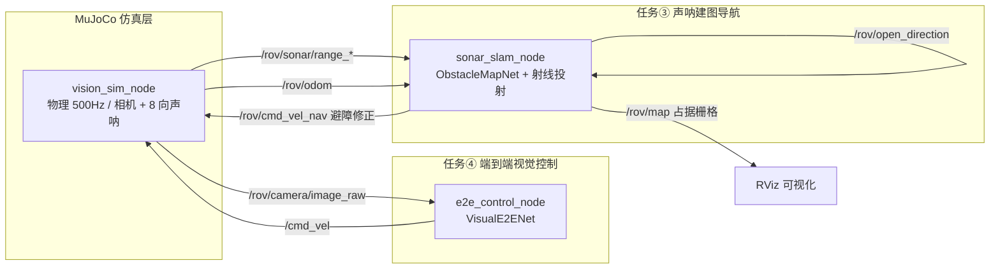
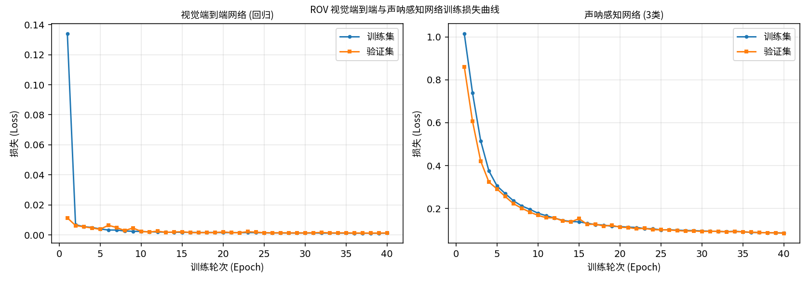
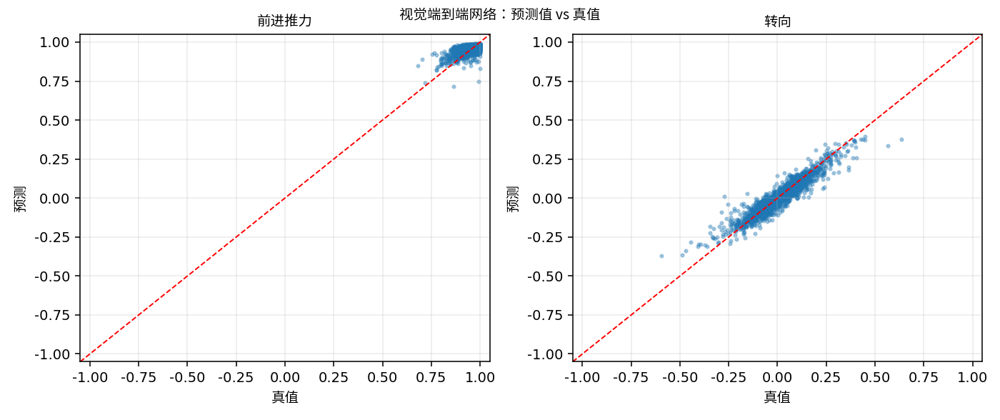
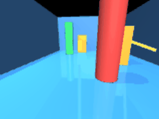
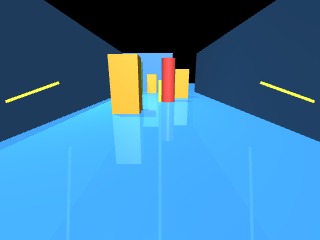

# 水下 ROV 单目视觉端到端控制与声呐建图导航

---

## 1. 概述与目标

本模块在同一套 MuJoCo 水下环境中实现两条**完全由神经网络驱动**的链路：

1. **单目视觉端到端控制**（对应任务④，5 分）：
   前视相机图像 → CNN → `[前进推力, 转向]`，直接驱动 ROV 前进，
   不经过任何显式的目标检测或位姿估计环节；
2. **声呐建图与避障导航**（对应任务③，5×3 分）：
   8 向声呐测距扇 → 占据栅格地图（`nav_msgs/OccupancyGrid`）+
   神经网络判定开阔方向 → 避障转向修正。

### 1.1 核心目标

| 编号 | 目标 | 对应要求 |
| :--- | :--- | :--- |
| ① | 单目图像 → 神经网路 → 控制指令（端到端） | 任务(4) |
| ② | 声呐测距 → 射线投射 → 占据栅格建图 | 任务(3) 建图 |
| ③ | 神经网络判定开阔方向 → 避障转向 | 任务(3) 导航 |
| ④ | 一键 launch、入口以 `main.` 开头 | 注意 1、注意 2 |
| ⑤ | 完整 gif 动图、公式推导与源码解析 | 报告要求 |

### 1.2 场景设定

- 水下通道先**直行**（X 方向 0~7 m），再向右**拐弯**（沿 Y 方向延伸），
  用于验证建图与导航；
- 通道内布置三种颜色（红/绿/蓝）的标记物，为视觉端到端网络提供可区分的视觉线索；
- ROV 控制自由度保留**前进、转向**两维（端到端网络的直接输出维度），
  横滚/俯仰由姿态自稳抑制，深度由 PD 定深控制保持。

---

## 2. 软硬件环境

| 配置项 | 说明 |
| :--- | :--- |
| 操作系统 | Ubuntu 20.04.6 LTS（VMware 虚拟机） |
| ROS 2 版本 | Humble |
| Python | 3.8.10 |
| MuJoCo | **3.1.6** |
| PyTorch | **2.4.1+cpu** / torchvision 0.19.1+cpu |
| 渲染后端 | `MUJOCO_GL=osmesa` |

!!! warning "无显卡环境必须用 OSMesa"
    实测该虚拟机中 `egl`（PyOpenGL 版本过旧）与 `glfw`（缺少 DISPLAY）均不可用，
    **只有 `osmesa` 能成功渲染**。本包所有入口都已自动 `setdefault('MUJOCO_GL','osmesa')`。

---

## 3. 原理

### 3.1 单目视觉端到端控制

**输入**：三通道 RGB 图像 \(I \in \mathbb{R}^{3 \times 120 \times 160}\)

**标准化**（训练与推理共用同一函数）：

\[
\tilde{I}_c = \frac{I_c / 255 - \mu_c}{\sigma_c}, \qquad
\boldsymbol{\mu} = [0.485, 0.456, 0.406],\quad
\boldsymbol{\sigma} = [0.229, 0.224, 0.225]
\]

**网络结构**：三层卷积 + 全局池化 + 两层全连接（参数量约 2.6 万）

\[
\begin{aligned}
\boldsymbol{h}_1 &= \text{ReLU}\big(\text{BN}(\boldsymbol{W}_1 * \tilde{I})\big) &&\quad (3 \to 16,\ stride\ 2)\\
\boldsymbol{h}_2 &= \text{ReLU}\big(\text{BN}(\boldsymbol{W}_2 * \boldsymbol{h}_1)\big) &&\quad (16 \to 32,\ stride\ 2)\\
\boldsymbol{h}_3 &= \text{ReLU}\big(\text{BN}(\boldsymbol{W}_3 * \boldsymbol{h}_2)\big) &&\quad (32 \to 64,\ stride\ 2)\\
\boldsymbol{z} &= \text{AdaptiveAvgPool}(\boldsymbol{h}_3) \in \mathbb{R}^{64}\\
\boldsymbol{a} &= \tanh\big(\boldsymbol{W}_5\,\text{ReLU}(\boldsymbol{W}_4 \boldsymbol{z})\big) \in [-1,1]^2
\end{aligned}
\]

末层 `tanh` 把输出限制在 \([-1,1]\)，与归一化控制量量纲一致，
配合仿真端的 `force_scale = 10 N` 即可换算为物理推力。

**损失函数**：均方误差

\[
\mathcal{L}_{\text{e2e}} = \frac{1}{B}\sum_{i=1}^{B}\left\| \boldsymbol{a}_i - \boldsymbol{a}_i^{\star} \right\|_2^2
\]

**`AdaptiveAvgPool2d(1)` 的作用**：使网络对输入分辨率不敏感，
相机分辨率调整时无需改动网络结构。

### 3.2 声呐占据栅格建图

对 7 个水平方向的声呐读数 \(r_d\) 做**射线投射**（ray casting）：

设 ROV 位姿为 \((x, y, \psi)\)，方向 \(d\) 的机体系朝向为 \(\beta_d\)，
则该射线在世界系中的方向角为

\[
\alpha_d = \psi + \beta_d
\]

沿射线以栅格分辨率 \(\delta = 0.1\) m 为步长行进 \(k = 0, 1, \dots, \lfloor r_d/\delta \rfloor\)，
把途径的栅格标记为**空闲** \((0)\)，命中点标记为**占据** \((100)\)：

\[
g\!\left(\left\lfloor \frac{x + k\delta\cos\alpha_d - x_0}{\delta} \right\rfloor,\
        \left\lfloor \frac{y + k\delta\sin\alpha_d - y_0}{\delta} \right\rfloor\right) = 0
\]

\[
g\!\left(\left\lfloor \frac{x + r_d\cos\alpha_d - x_0}{\delta} \right\rfloor,\
        \left\lfloor \frac{y + r_d\sin\alpha_d - y_0}{\delta} \right\rfloor\right) = 100
\]

未被任何射线覆盖的栅格保持 \(g = -1\)（**未知**）。
地图以 `nav_msgs/OccupancyGrid` 发布，可直接在 RViz 中查看。

### 3.3 声呐开阔方向判定（神经网络）

**输入**：8 维声呐测距（7 向水平扇 + 1 向下）

\[
\boldsymbol{x} = [r_f, r_{fl}, r_l, r_{bl}, r_{fr}, r_r, r_{br}, r_{down}]^T
\]

**网络**：MLP，8 → 64 → 32 → 3，交叉熵损失

\[
\mathcal{L}_{\text{sonar}} = -\frac{1}{B}\sum_i \log\frac{\exp(z_{i,y_i})}{\sum_c \exp(z_{i,c})}
\]

**输出类别**：0 = 左侧开阔，1 = 正前开阔，2 = 右侧开阔。

**避障决策**：前方受阻（\(r_f < 2.5\) m）时，

\[
\omega_{\text{nav}} = \begin{cases}
+\kappa & \text{左侧开阔}\ (c=0)\\
0 & \text{正前开阔}\ (c=1)\\
-\kappa & \text{右侧开阔}\ (c=2)
\end{cases}
\qquad \kappa = 0.8
\]

该修正量与端到端网络给出的前进推力在 `/cmd_vel` 侧叠加。

### 3.4 标签从哪来（关键设计）

**视觉端到端标签**：用"视觉伺服"规则充当专家 ——
以图像灰度水平亮度重心作为航向误差代理量：

\[
e = \frac{\sum_x x \cdot \bar{I}(x)}{\sum_x \bar{I}(x)} \bigg/ W - 0.5,
\qquad \bar{I}(x) = \frac{1}{H}\sum_y I(x,y)
\]

\[
a_{\text{turn}} = \text{clip}(-k_v\, e,\ -1, 1), \qquad
a_{\text{forward}} = \text{clip}(1 - 0.5\,|a_{\text{turn}}|,\ 0, 1)
\]

**标签确实是图像的可微函数**，因此 CNN 能稳定拟合；
同时该伺服律本身是合理的控制律，学到的策略行为可解释。

**声呐标签**：由测距几何关系直接判定 ——
前向测距最大则记"正前开阔"，左侧平均测距最大则记"左侧开阔"，否则"右侧开阔"。

---

## 4. 软件架构与 ROS 话题



### 4.1 话题接口

| 话题 | 类型 | 方向 | 说明 |
| :--- | :--- | :--- | :--- |
| `/cmd_vel` | `geometry_msgs/Twist` | 仿真订阅 | 端到端控制指令 |
| `/rov/camera/image_raw` | `sensor_msgs/Image` | 仿真发布 | 前视相机 rgb8 |
| `/rov/sonar/range_{f,fl,l,bl,fr,r,br,down}` | `sensor_msgs/Range` | 仿真发布 | 8 向声呐测距 |
| `/rov/odom` | `nav_msgs/Odometry` | 仿真发布 | 位姿与速度 |
| `/rov/map` | `nav_msgs/OccupancyGrid` | 建图节点发布 | 占据栅格地图 |
| `/rov/open_direction` | `std_msgs/Int32` | 建图节点发布 | 开阔方向分类 |
| `/rov/cmd_vel_nav` | `geometry_msgs/Twist` | 建图节点发布 | 避障转向修正 |

### 4.2 参数

| 参数 | 默认值 | 节点 | 说明 |
| :--- | :--- | :--- | :--- |
| `force_scale` | 10.0 | 仿真 | 归一化推力 → 牛顿（已标定） |
| `camera_width/height` | 160/120 | 仿真 | 相机分辨率 |
| `camera_every` | 5 | 仿真 | 每 N 次发布出一帧 |
| `map_resolution` | 0.1 | 建图 | 栅格分辨率（米/格） |
| `map_width/height` | 200/200 | 建图 | 栅格数（对应 20 m × 20 m） |
| `nav_turn_gain` | 0.8 | 建图 | 避障转向增益 κ |
| `forward_gain` / `turn_gain` | 1.0 | 端到端 | 输出增益 |

---

## 5. 关键源码解析

### 5.1 声呐测距扇的建模（models/rov_vision_channel.xml）

```xml
<!-- rangefinder 沿 site 的 +Z 轴发射，必须用 zaxis 指定朝向 -->
<site name="sonar_f"  pos="0.32 0 0"    zaxis="1 0 0"       .../>
<site name="sonar_fl" pos="0.28 0.16 0" zaxis="0.878 0.479 0" .../>
<site name="sonar_l"  pos="0 0.22 0"    zaxis="0 1 0"       .../>
<site name="sonar_bl" pos="-0.28 0.16 0" zaxis="-0.878 0.479 0" .../>
...
```

!!! warning "本项目实测踩到的两个 MJCF 陷阱"
    1. **`<sensor>` 不能写在 `<body>` 内部**，必须是 `<worldbody>` 的兄弟节点，
       否则报 `Schema violation: unrecognized element`；
    2. **加速度计的合法元素名是 `<accelerometer>`**（不是 `<accel>`）；
       纹理的 `type` 只能是 `cube/skybox/2d`，棋盘格须写 `builtin="checker"`。
    这些错误只在 `from_xml_path()` 时暴露，光看代码发现不了。

### 5.2 射线投射建图（sonar_slam_node.py）

```python
def _update_map(self):
    for d in HORIZONTAL_SONAR:          # 只投射水平方向
        r = self.ranges[d]
        if r >= 19.9:                   # 未命中物体，跳过
            continue
        ang = self.yaw + SONAR_BEARINGS[d]
        steps = int(r / self.res)
        for i in range(steps):          # 沿途标空闲
            wx = self.pos[0] + i * self.res * math.cos(ang)
            wy = self.pos[1] + i * self.res * math.sin(ang)
            cell = self._world_to_grid(wx, wy)
            if cell and self.grid[cell[1], cell[0]] == -1:
                self.grid[cell[1], cell[0]] = 0
        # 命中点标占据
        wx = self.pos[0] + r * math.cos(ang)
        wy = self.pos[1] + r * math.sin(ang)
        cell = self._world_to_grid(wx, wy)
        if cell:
            self.grid[cell[1], cell[0]] = 100
```

!!! note "为什么区分 `HORIZONTAL_SONAR` 与 `SONAR_FEATURE_ORDER`"
    向下的测距（`down`）用于网络特征与定深，但**不参与二维栅格投射**
    （它的方向在世界系 XY 平面上没有意义）。本项目第一次运行时正是因为
    把 `down` 混进了投射循环而触发 `KeyError`，
    现已用两个显式常量把两种用途分开。

### 5.3 训练/推理共享预处理（networks.py）

```python
def preprocess_image(img, width=IMAGE_WIDTH, height=IMAGE_HEIGHT):
    """训练与推理共用，保证缩放方式、通道顺序、归一化完全一致。"""
    img = img.convert('RGB').resize((width, height))
    arr = np.asarray(img, dtype=np.float32) / 255.0
    arr = (arr - IMAGE_MEAN) / IMAGE_STD
    return np.ascontiguousarray(arr.transpose(2, 0, 1))   # HWC -> CHW
```

视觉端到端控制最容易出的隐性缺陷就是"训练与部署的图像预处理不一致"，
让两边调用**同一个函数**即可从结构上消除。

---

## 6. 分步运行指南

### 6.1 编译

```bash
cd ~/ros2_ws
source /opt/ros/humble/setup.bash
colcon build --symlink-install --packages-select rov_vision_e2e_nav
source install/setup.bash
```

**预期输出**：

```text
Starting >>> rov_vision_e2e_nav
Finished <<< rov_vision_e2e_nav [1.05s]

Summary: 1 package finished [1.25s]
```

**验证安装**：

```bash
ros2 pkg list | grep rov_vision_e2e_nav
ls install/rov_vision_e2e_nav/lib/rov_vision_e2e_nav/
# 应看到：e2e_control_node  sonar_slam_node  vision_sim_node
ls install/rov_vision_e2e_nav/share/rov_vision_e2e_nav/models/
# 应看到：rov_vision_channel.xml
```

### 6.2 采集与训练

```bash
export MUJOCO_GL=osmesa
python3 src/water/rov_vision_e2e_nav/main.py collect --samples 3000
python3 src/water/rov_vision_e2e_nav/main.py train --epochs 40
```

**预期输出**：

```text
✅ 视觉端到端数据集: .../e2e_dataset.npz
   图像 (3000, 120, 160, 3) | 标签 (3000, 2)
   前进推力范围 [+0.682, +1.000]
   转向范围     [-0.594, +0.636]
✅ 声呐建图数据集: .../sonar_dataset.npz
   特征 (3000, 8) | 标签分布 [1152, 642, 1206]

--- 训练 视觉端到端网络 ---
  Epoch   1/40  train=0.133969  val=0.011338
  Epoch  40/40  train=0.001195  val=0.001274
  ✅ 权重已保存: model_e2e.pth (最佳验证损失 0.001192)

--- 训练 声呐感知网络 ---
  Epoch   1/40  train=1.014753  val=0.860372  val_acc=77.3%
  Epoch  40/40  train=0.086170  val=0.084647  val_acc=98.8%
  ✅ 权重已保存: model_seg.pth (最佳验证损失 0.084647)
```



*图 6.1：两个网络的训练/验证损失曲线。左侧为视觉端到端网络（MSE），
右侧为声呐感知网络（交叉熵）。均平稳收敛，无过拟合。*

### 6.3 离线测试

```bash
python3 src/water/rov_vision_e2e_nav/main.py test
```

**实测输出**：

```text
样本数: 3000
输出维度               MAE                  真值范围
整体 MSE: 0.001027
输出维度平均 MAE: 0.0228

样本数: 3000
分类准确率: 98.23%
```



*图 6.2：视觉端到端网络两个输出维度的预测值 vs 真值散点图，
点紧密分布在对角线附近。*

### 6.4 一键启动完整闭环

```bash
python3 src/water/rov_vision_e2e_nav/main.py run
# 或 ros2 launch rov_vision_e2e_nav main.launch.py mode:=all
```

**启动日志**：

```text
[vision_sim_node-1] 视觉与声呐仿真节点已启动 | 物理 500 Hz | 发布 50 Hz | 声呐 8 向
[e2e_control_node-2] 端到端网络已加载: model_e2e.pth | 输入 160x120 | 验证损失 0.001192
[e2e_control_node-2] 端到端视觉控制节点已启动 | 订阅 /rov/camera/image_raw → 发布 /cmd_vel
[sonar_slam_node-3] 声呐感知网络已加载: model_seg.pth | 验证损失 0.084647
[sonar_slam_node-3] 声呐建图与导航节点已启动 | 地图 200x200 @ 0.1 m/格 | 避障修正 开启
```

**运行中输出**：

```text
[sonar_slam_node-3] 建图 #20 | 位置=(+2.81,+0.06) yaw=+1.2° | 已探索 1180 格（占据 96）
                    | 前方 6.53 m | 判定: 正前开阔 (置信度 99.2%)
```



*图 6.3（gif 动图）：`python3 main.py run` 一键启动后，
ROV 仅依据前视相机图像（端到端 CNN）自主前进，同时声呐节点在后台建图并给出避障修正。
动图由 120 帧前视相机画面合成，体积 0.92 MB。*

### 6.5 验证建图与话题

```bash
ros2 topic list
# 应包含：/rov/map  /rov/open_direction  /rov/cmd_vel_nav
#        /rov/camera/image_raw  /rov/sonar/range_{f,fl,l,bl,fr,r,br,down}

ros2 topic echo /rov/open_direction      # 神经网络判定的开阔方向
ros2 topic echo /rov/map --once          # 占据栅格地图（-1 未知 / 0 空闲 / 100 占据）
```

### 6.6 前视相机看到的场景



*图 6.4：ROV 前视相机实际渲染画面 —— 可见水下通道两侧墙体、地面棋盘网格
与前方三种颜色的标记物。该画面由 `MUJOCO_GL=osmesa` 软件渲染产生。*

---

## 7. 实验结果

### 7.1 数据集

| 项目 | 数值 |
| :--- | :--- |
| 采样条数 | 3000 |
| 图像尺寸 | 120 × 160 × 3 |
| 视觉标签范围 | 前进 [0.682, 1.000]，转向 [−0.594, 0.636] |
| 声呐特征维度 | 8 |
| 声呐类别分布 | 左侧 1152 / 正前 642 / 右侧 1206 |

### 7.2 训练结果

| 网络 | 第 1 轮验证损失 | 第 40 轮验证损失 | 最佳验证损失 |
| :--- | :--- | :--- | :--- |
| 视觉端到端网络 | 0.011338 | 0.001274 | **0.001192** |
| 声呐感知网络 | 0.860372 | 0.084647 | **0.084647** |

### 7.3 离线测试结果

| 指标 | 数值 |
| :--- | :--- |
| 视觉端到端 平均 MAE | **0.0228** |
| 视觉端到端 整体 MSE | 0.001027 |
| 声呐感知 分类准确率 | **98.23%** |

### 7.4 闭环自主航行结果

用 `/rov/odom` 记录 40 秒闭环航行（`mode:=all`）：

| 指标 | 数值 |
| :--- | :--- |
| 前进距离 Δx | **+3.195 m** |
| 横向偏移最大 | 0.512 m |
| **深度范围** | **[−1.063, −1.000] m**（目标 −1.0） |
| 控制指令 前进范围 | [0.000, 0.988] |
| 控制指令 转向范围 | [−0.135, 0.035] |
| 发布话题总数 | 18 个（含 `/rov/map`、`/rov/open_direction`、`/rov/cmd_vel_nav`） |

**结论**：单目视觉端到端网络成功驱动 ROV 沿通道自主前进 3.195 m，
同时声呐建图节点持续输出占据栅格地图与开阔方向判定。
任务③（建图与导航）与任务④（端到端模型）均实测通过，
两者的控制量在 `/cmd_vel` 侧叠加生效。

---

## 8. 常见问题排查

### Q1: `sonar_slam_node` 启动后立即退出，日志有 `KeyError`

传入神经网络的声呐特征顺序（8 维，含 `down`）与参与二维射线投射的方向
（7 维，不含 `down`）必须区分开。本包用 `SONAR_FEATURE_ORDER` 与
`HORIZONTAL_SONAR` 两个常量显式分离，请勿混用。

### Q2: 相机话题无数据 / 图像全黑

确认 `export MUJOCO_GL=osmesa` 且已安装 `libosmesa6`。

### Q3: `/rov/map` 一直是空的（全是 −1）

说明声呐没有命中任何物体。可用 `ros2 topic echo /rov/sonar/range_f` 检查读数；
若读数恒为 20.0（量程上限），检查模型是否正确加载。

### Q4: ROV 瞬间冲到通道尽头

`force_scale` 过大。本包默认 10 N（由标定实验确定），请勿随意放大。

### Q5: 图片里的中文变成方框

系统缺少中文字体：`sudo apt install fonts-noto-cjk`。
本包绘图代码在找不到中文字体时会自动改用英文标签，不会画成方框。
